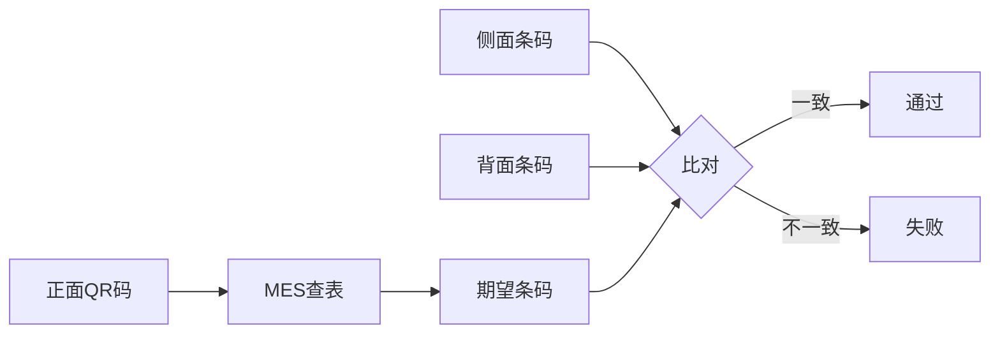
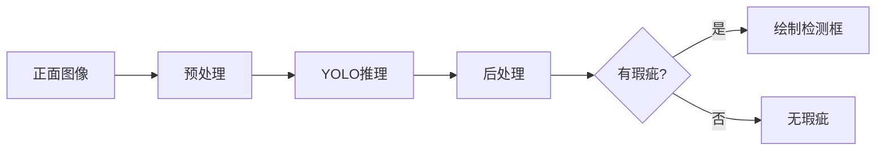

# 快速入门

5分钟快速上手 JuShen 瑕疵检测系统。

## 前提条件

- 已完成[安装指南](installation.md)中的步骤
- Python 环境已激活
- 所有依赖已安装

## 快速运行 Demo

### 步骤1：启动系统

```bash
cd JuShen-xiaci-detect
python app.py
```

系统会显示启动画面，加载配置和模型。

### 步骤2：选择样品

界面打开后：
1. 在右上角下拉框中选择样品编号（如 `2`）
2. 系统自动加载三视角图像预览

### 步骤3：执行检测

1. 点击「开始检测」按钮
2. 观察检测过程：
   - 正面二维码识别
   - MES查表
   - 侧面/背面条码识别
   - 瑕疵检测
3. 查看检测结果

### 步骤4：查看结果

检测完成后，界面显示：
- ✅ 三个视角的标注图像
- ✅ 四个步骤的状态灯（通过/失败）
- ✅ 总体判定（PASS/FAIL）
- ✅ 详细检测报告
- ✅ 完整检测日志

## 演示样品说明

项目提供 10 个演示样品（1-10）：

| 样品ID | 三码比对 | 瑕疵检测 | 总体结果 |
|--------|----------|----------|----------|
| 2 | ✅ 通过 | ✅ 无瑕疵 | **PASS** |
| 3 | ✅ 通过 | ❌ 3处瑕疵 | **FAIL** |
| 6 | ✅ 通过 | ❌ 1处瑕疵 | **FAIL** |
| 其他 | ✅ 通过 | ✅ 无瑕疵 | **PASS** |

## 命令行快速测试

如果不想使用GUI，可以使用Python脚本快速测试：

```python
from pathlib import Path
from pipeline import InspectionPipeline

# 初始化
ROOT = Path(__file__).parent
DATA_ROOT = ROOT / "data"
MES_PATH = ROOT / "MES-ID.cgf"
MODEL_PATH = ROOT / "models" / "best.pt"

pipeline = InspectionPipeline(MES_PATH, MODEL_PATH)

# 执行检测
result = pipeline.inspect_sample_dir(DATA_ROOT, "2")

# 查看结果
print(f"总体结论: {result.overall}")
print(f"检测信息: {result.overall_message}")
print(f"三码比对: {result.compare.status}")
print(f"瑕疵检测: {result.defect.status}")
```

## 常用操作

### 切换样品

- 点击「上一张」/「下一张」按钮
- 或直接在下拉框中选择

### 查看系统信息

菜单栏 → 帮助 → 系统信息

显示：
- 系统硬件信息
- Python 和依赖版本
- CUDA 状态
- MES 记录数
- 样品总数

### 刷新样品列表

菜单栏 → 文件 → 刷新样品列表

适用于动态添加新样品后。

### 查看检测日志

检测完成后，详细日志会显示在界面底部。

日志保存位置：`logs/inspection_YYYYMMDD.log`

## 理解检测流程

### 1. 三码比对



**要求**：侧面 == 背面 == MES条码

### 2. 瑕疵检测



**输出**：检测框、类别、置信度

## 检测结果说明

### 状态灯含义

| 颜色 | 状态 | 说明 |
|------|------|------|
| 🟢 绿色 | 通过 | 该步骤检测成功 |
| 🔴 红色 | 失败 | 该步骤检测失败 |
| 🟡 黄色 | 待检 | 等待检测 |
| ⚪ 灰色 | 跳过 | 因前序失败而跳过 |

### 总体判定逻辑

- **PASS**: 三码比对通过 **且** 无瑕疵
- **FAIL**: 三码比对失败 **或** 有瑕疵

## 自定义测试

### 添加新样品

1. 准备三视角图像：
   ```
   data/front/{id}-1.jpg  # 正面
   data/side/{id}-3.jpg   # 侧面
   data/back/{id}-2.jpg   # 背面
   ```

2. 更新 MES 数据：
   编辑 `MES-ID.cgf`，添加：
   ```
   {正面QR码},{期望条码},1
   ```

3. 刷新样品列表

4. 执行检测

### 使用标注文件

如果要模拟瑕疵检测结果：

1. 使用 LabelImg 标注正面图像
2. 保存为 `data/front/annotations/{id}-1.xml`
3. 系统会优先使用标注框

标注教程：[数据标注指南](dataset/labeling.md)

## 性能测试

测试检测速度：

```python
import time
from pipeline import InspectionPipeline
from pathlib import Path

pipeline = InspectionPipeline("MES-ID.cgf", "models/best.pt")
DATA_ROOT = Path("data")

# 测试10次取平均
times = []
for i in range(10):
    start = time.time()
    result = pipeline.inspect_sample_dir(DATA_ROOT, "2")
    elapsed = time.time() - start
    times.append(elapsed)

print(f"平均耗时: {sum(times)/len(times):.3f}s")
print(f"最快: {min(times):.3f}s")
print(f"最慢: {max(times):.3f}s")
```

## 下一步

- 📖 阅读 [API 文档](api/) 了解接口
- 🔧 学习 [开发指南](development/) 进行定制
- 🚀 参考 [部署文档](deployment/) 用于生产

## 常见问题

### Q: 检测速度慢怎么办？

A: 
1. 使用 GPU 加速
2. 调整 `config.yaml` 中的 `time_factor`
3. 升级硬件配置

### Q: 识别失败怎么办？

A:
1. 检查图像质量（清晰度、光照）
2. 确认二维码/条码格式正确
3. 查看 `logs/` 目录的详细日志

### Q: 如何批量检测？

A: 编写脚本遍历样品ID：

```python
for sample_id in ["1", "2", "3", "4", "5"]:
    result = pipeline.inspect_sample_dir(DATA_ROOT, sample_id)
    print(f"{sample_id}: {result.overall}")
```

## 获取帮助

- 📚 [完整文档](README.md)
- 🐛 [报告问题](https://github.com/1984930808/JuShen-xiaci-detect/issues)
- 💬 [讨论区](https://github.com/1984930808/JuShen-xiaci-detect/discussions)
